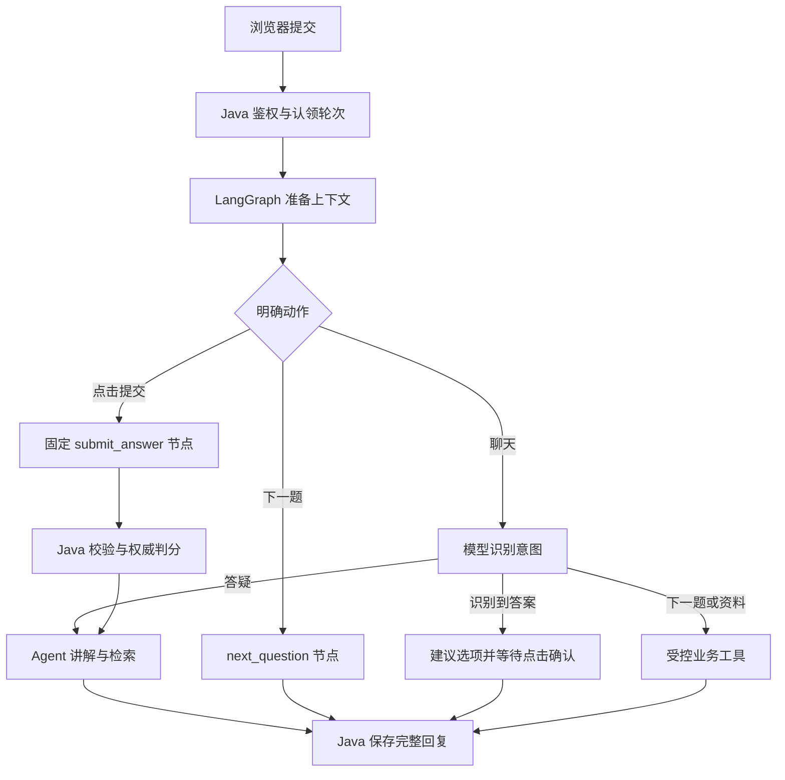

# 做题 Agent 的 LangGraph 编排

日期：2026-11-11。状态：代码实现与离线验收完成；真实本机模型联调待加载两端新代码后验证。

## 目标与架构决策

浏览器仍请求Java鉴权入口。Java认领幂等轮次、保存用户消息并颁发短期授权；Python LangGraph负责该轮路由、固定提交判分节点和动态讲解工具循环；Java提供受控业务工具、保存权威题目/答案/判分与最终消息。明确点击提交不经过LLM决策或改写，含糊文本作答仍只建议选项并等待用户确认。

Python编排检查点使用本机SQLite，不访问业务PG。检查点用于保存图进度，不自动重放付费生成；Java完成轮次后同requestId直接重放保存结果。运行中断后判分不得丢失，讲解失败不回滚已提交答案。检查点不是第二份权威学习数据库。



LangGraph承载流程；判题是否需要模型决策、判题逻辑放在哪里是另外两个问题。本项目明确提交直接进入固定节点，Java依据题目快照判分，模型只消费已提交的结果。题目选择与资料创建等能力也经受控业务工具回调，不为“Agent范式”增加一次无必要的判题推理。

## 跨服务契约

Java → Python `POST /internal/coach-workflow`，HMAC鉴权，JSON：

```text
{scope:"student",workflow_id:"<sessionId>:<requestId>",
 action:"answer"|"next"|"chat",grant:"短期授权凭证",context:CoachRequest}
```

context沿用既有可见题目/历史/考纲/已判分结果，不提前暴露标准答案。grant不能进入模型消息或审计原文；绑定用户、登录会话、学习会话、requestId、请求摘要、明确动作与选项，带过期时间。签发/验签只由Java完成。

Python → Java 固定配置地址的 `POST /internal/coach/workflow-step`，同时验证内部HMAC和grant：

```text
{grant,step:"context"|"submit_answer"|"next_question"|"suggest_answer"|"clarify"|"create_material",
 keys?:string[],reply?:string,suggestions?:list}
→ {code,message,data:{context:CoachRequest},traceId}
```

submit_answer只使用Java签发时已确认的选项/题目标识，不接受模型提供标准答案或任意用户ID；仅固定图节点调用，不注册到LLM自由选工具列表。其他业务工具继续由Java检查当前状态和权限；重复step不得重复推进题目、提交判分或创建资料。网络调用前释放数据库事务/行锁。

Python SSE沿用delta/tool_status/tool_audit/sources/suggestions，增加内部workflow_state（只作Java重新读取权威状态的信号）和workflow_result（kind=state_only|explain）；末尾done。Java验证完整终态后结束轮次。state_only允许无正文，例如下一题/候选答案确认/资料创建。

## 实施任务

- [x] Java内部工具：轮次授权、HMAC精确白名单、归属/登录状态/取消/重复调用校验，复用原有判分与题目选择。
- [x] Python图：准备上下文→固定提交或短意图路由→受控业务工具→Agent讲解→终态；持久SQLite检查点和无自动重试的回调客户端。
- [x] Java公开流入口切换到新图，保留原路径作为显式回滚配置；最终状态从Java读取，回调原文不直接作为客户端权威状态。
- [x] 跨语言回归：明确提交不触发路由模型、提示式答案只产生确认、重复回调幂等、旧登录/过期授权/跨会话拒绝、取消或删除不复活、已判分而讲解失败保留结果。
- [x] 文档与本机配置说明、检查点读写/重启验证、全量离线测试。真实模型/NAS写入及用户服务重启不在本次自动执行范围。

## 重点边界

1. Java给Python的答案字段只能在权威判分完成后出现。
2. Python回调Java时原HTTP请求不能持有会话行锁。
3. 授权只用于原轮次，不能变成任意内部业务入口；Admin身份不因此获得学习权限。
4. SQLite检查点不能触发对中断模型调用的自动计费重放；明确保留失败/人工继续语义。
5. 当前学习资料API/MQ开关及选题权限不因编排改造自动放开。

## 文件分工与验证方式

- Java：`coach`中的工作流授权、内部接口和流式客户端；沿用`StudentCoachService`的题目选择、判分、会话认领与最终保存。通过API H2测试覆盖重复回调、权限失效、取消/删除与故障后的权威状态。
- Python：独立编排图、内部路由、Java回调客户端与检查点生命周期；复用原有短意图识别、讲解解析和工具循环。通过替身模型验证固定提交不调用路由模型、自然语言作答只产生确认、失败不重试，以及SQLite关闭后重新打开仍能读到图状态。
- 集成：保持浏览器SSE契约，内部`workflow_state`只触发Java读取状态。替身Python/Java覆盖双向HTTP契约，不能将单边Mock成功等同真实供应商联调。

离线检查使用`./backend/mvnw -B -ntp -pl api-java -am verify`、`uv --directory backend/ai-python run pytest -q`及Ruff；真实本机验收另需用户加载两端新代码后执行。


## 实现与运行配置

Java新增`CoachWorkflowGrant`、`CoachWorkflowInternalFilter`、`CoachWorkflowInternalController`，流式入口在`StudentCoachService`按开关选择新图。授权有效期180秒；HMAC仅允许精确POST，拒绝重复鉴权头、query和nonce重放。业务步骤在`state_json._workflow`记录原轮次和已执行步骤，不向浏览器公开；同轮重复步骤不再产生业务副作用。终结轮次和回调使用同一会话行锁，终结时重新读取最新权威状态再追加完整回复，避免失败善后覆盖正在提交的判分。

Python新增`app/agent/coach_workflow.py`、`app/api/coach_workflow.py`与`app/clients/coach_workflow.py`。图使用官方`langgraph-checkpoint-sqlite`的`AsyncSqliteSaver`；授权仅放本次执行的runtime context，不进入图state/configurable、检查点或模型提示词。检查点包含对话和已提交结果，当前没有自动清理策略，应作为本机私人数据保护。

明确提交的准备阶段不调用考纲Embedding，Java判分提交后才检索讲解依据；聊天在prepare检索一次；明确下一题不检索。所有上下文检索都在业务事务提交后执行。讲解工具循环仍复用原实现，未把每次搜索/抓取都拆成独立图节点。

| 配置 | 默认值 / 用途 |
| --- | --- |
| Java `quest.coach.harness.enabled` | `true`；设为`false`显式回退旧流式编排 |
| Python `COACH_API_URL` | `http://127.0.0.1:8080`；固定Java回调地址，容器中需显式配置可达地址 |
| Python `COACH_CHECKPOINT_PATH` | `runtime/coach-checkpoints.sqlite`，相对Python工作目录；脚本启动时为`backend/ai-python` |
| 内部认证 | 沿用两端一致的`INTERNAL_SERVICE_TOKEN`与`INTERNAL_HMAC_SECRET`；grant另用Java独有密钥签发 |
| 超时 | Python整图130秒，讲解工具阶段90秒；Java内部流135秒，Controller140秒取消 |

新目录0700、SQLite文件0600；runtime已忽略Git与Docker构建上下文，容器预建可写目录。检查点不是自动续跑承诺：同一workflow_id已执行或中断时拒绝再次运行，已完成的业务响应由Java幂等重放；用户用新轮次继续。业务PG结构不变，无新增迁移。

## 本轮验证与本机测试

离线验证：Python完整721项通过，Ruff检查与87文件格式检查通过；Java API/common完整verify通过（当时API175、common15），并发终态修复后62项定向回归及最终12项编排测试通过；前端shared122项、双端类型检查及修改文件格式检查通过；配置/部署契约38项、39份Markdown链接与迁移副本检查通过。独立审查发现的旧快照覆盖并发判分问题已修复并通过范围复审。未执行Docker镜像构建、真实供应商调用、NAS写入或用户进程重启。

本机验证步骤：

1. 从仓库根执行`uv --directory backend/ai-python sync --group dev --frozen`，加载新增SQLite依赖。不要用模板覆盖已有配置。
2. 重启自己的Java API和Python服务；保持当前内部凭据一致，前端刷新即可。普通做题无需Worker。
3. 开始练习并点击提交，确认对错先显示，再出现讲解；刷新仍保留作答。输入“我选A”时只应高亮候选并要求点击确认。
4. 测试下一题、普通聊天与联网来源；取消或中断讲解后重新打开会话，检查已完成的判分仍在，半截正文没有作为成功消息保存。
5. 停止并重启Python，检查SQLite文件保留；重复已完成的requestId应由Java读取原结果，不再次调用模型。真实断网、供应商tool calling与NAS上的现有数据仍需本机实际验收。
