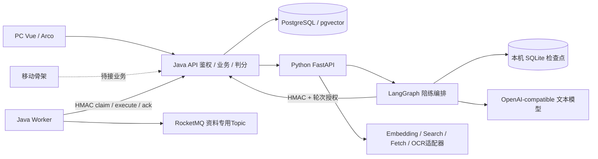

# 架构与技术栈

更新：2026-11-11。实现事实依据当前源码、依赖清单和测试核对；不以旧文档推定运行状态。

OCR节点表示已有适配器，不表示PDF上传已调用OCR。Redis、S3服务有独立部署配置，目前不在已完成核心业务数据路径内。

## 工程与运行职责

- `backend` Maven多模块：common为领域契约/确定性判分；api-java为HTTP及业务库写入边界；worker-java为资料消息中继/消费者，不直接写业务库，也不直接调用模型。
- `backend/ai-python` 独立uv工程：FastAPI内部能力、PDF隔离子进程、受控提取图、模型输出校验、陪练工具循环、资料长输出。Python没有业务库写入代码。
- `frontend` pnpm workspace：PC Vue/Arco、移动Vue/Vant、shared协议/HTTP/SSE/安全Markdown/身份状态。PC拥有真实业务，移动仍是骨架。
- 代码基线：Java27/Spring Boot4.1.2/Jackson3；业务持久化当前主要JdbcTemplate，MyBatis-Plus已引依赖；PostgreSQL16；Python>=3.11；Vue3/TypeScript5.9/Vite7。安装锁版本详各工程README。

## 数据与任务

公共PDF原件在`public_import_document.file_bytes`，考纲文件在`syllabus_file`；学习资料Markdown和快照在业务表；陪练消息/题目快照/来源保存在`student_coach_session.state_json`。当前不是所有文件都走对象存储。

公共导入：HTTP→保存预检/任务→有界执行器逐题调用Python→校验草稿→人工确认→发布。全局扫库与显式批次启动分开，不自动发布。

考纲：版本/章节→持久化任务→AI整理→人工启用→切片/Embedding→PG保存→版本/科目/模型/维度过滤→Java有限候选余弦；失败同版本关键词降级。归档和历史会话引用有独立读取规则，不跨版本混向量。

陪练：Java认领幂等轮次并保存用户消息→Python LangGraph准备上下文→明确提交固定进入判分节点，聊天走意图路由→受限回调Java执行业务动作→必要时Agent讲解与只读工具→Java重新读取权威状态、保存完整消息→done。Java在回调前释放事务，回调根据短期授权校验原用户/登录/会话/轮次，并幂等执行；未判分时context没有标准答案。图检查点保存在本机SQLite，不连接业务PG、不自动重放付费生成。旧同步与显式关闭Harness的兼容路径仍保留。详见[编排技术说明](做题Agent编排技术说明.md)。

学习资料：用户请求→不可变快照+资料行+事务outbox→Worker发布MQ→消费者HMAC调用API→API认领generation/lease并调用Python→保存ready/failed→前端读取/下载。消息重投与付费模型重试分开；旧通用outbox仍未实现。

## 安全与协议

业务普通JSON为`{code,message,data,traceId}`；Actuator原生格式，SSE采用fetch POST。终端所有业务由Java鉴权；JWT之外还核对数据库会话、状态和角色。Admin管理公共内容及系统日志，不能进入Student学习业务；审计详情可能含业务原文，应按现有Admin日志授权管理，不能笼统承诺所有原文对Admin均不可见。

Java内部开放三个精确资料POST和`/internal/coach/workflow-step`给对应HMAC过滤器，其余internal默认拒绝；陪练回调另外验证Java签发的短期轮次授权；Python内部也校验token/HMAC/时间窗/nonce/body摘要，单进程nonce不是分布式防重放。Python调用和网页结果均不可信，不能改Java判分。

存储/接口使用UTC；展示与业务日期按Asia/Shanghai。跨用户的会话、资料等查询必须带身份归属。当前没有真正的应用MCP协议、长期记忆系统或完整私人RAG。

## 部署边界

应用本机运行，NAS配置独立管理。`local` profile为无持久化健康底座，不能假装PG已连通；`deployment`启用业务PG且readiness包含数据库。Flyway默认关闭，迁移脚本存在不代表共享数据库已执行。
